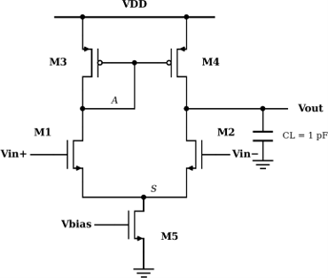
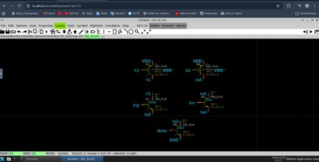
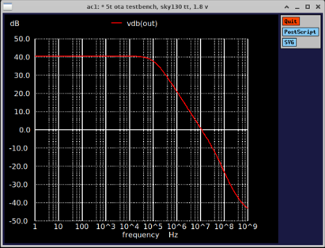
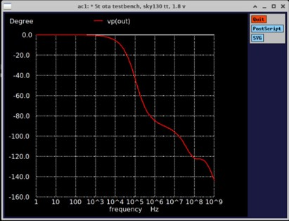

# 5T OTA Design and Verification on SKY130

Single-ended 5-transistor OTA (NMOS input pair, PMOS current-mirror load, NMOS tail source) designed from hand calculations and verified with xschem + ngspice on the SkyWater SKY130A PDK (1.8 V supply, CL = 1 pF).

## Specs and results (typical corner, 27 °C)

| Parameter | Spec | Hand calc | Simulation | Result |
|---|---|---|---|---|
| DC gain | ≥ 40 dB | 43.9 dB | 40.56 dB | Pass |
| GBW | ≥ 10 MHz | 11.94 MHz | 11.10 MHz | Pass |
| Phase margin | ≥ 60° | not calculated | 83.5° | Pass |
| Supply current | ≤ 20 µA | 15 µA | 13.62 µA | Pass |
| ICMR | includes 0.9 V | n/a | lower limit ≈ 0.88 V | Pass (small margin) |

## Sizing

| Device | Type | W/L (µm) |
|---|---|---|
| M1, M2 | NMOS (input pair) | 3.3 / 2 |
| M3, M4 | PMOS (mirror load) | 9.5 / 2 |
| M5 | NMOS (tail, Itail = 15 µA) | 23 / 1 |

Design flow: specs → topology → required gm from GBW → tail current → L from gain budget → W from gm/ID data → xschem schematic → ngspice (DC, AC, ICMR) → hand calculation vs simulation.

## Schematic and simulation results

**xschem schematic**

**Open-loop gain**

**Open-loop phase**

More plots (DC operating point, ICMR) are in the `images/` folder and in the report.

## Limitations

- Only the typical corner was simulated; other corners and temperatures were not checked.
- DC gain margin is only 0.56 dB, and the ICMR lower-limit margin is about 17 mV.
- Simulated gain is 3.3 dB below the hand calculation (PMOS gds was assumed equal to NMOS); the exact cause was not isolated.
- ICMR was judged from tail current only, not by re-checking gain at each VCM.

## Tools

Docker, IIC-OSIC-TOOLS, xschem, ngspice, SKY130A PDK.

## Files

- `report/`: full report with hand calculations
- `schematic/`: xschem schematic (`ota_5t.sch`)
- `sim/`: testbenches (`tb_ota.cir`, `tb_icmr.cir`) and device lines from the xschem netlist (`devs.txt`)
- `images/`: schematic and simulation screenshots

## How to run

Open the IIC-OSIC-TOOLS container, run `sak-pdk sky130A`, copy the files from `sim/` to `/foss/designs`, then run `ngspice tb_ota.cir`.

Author: Hasnain Ali
